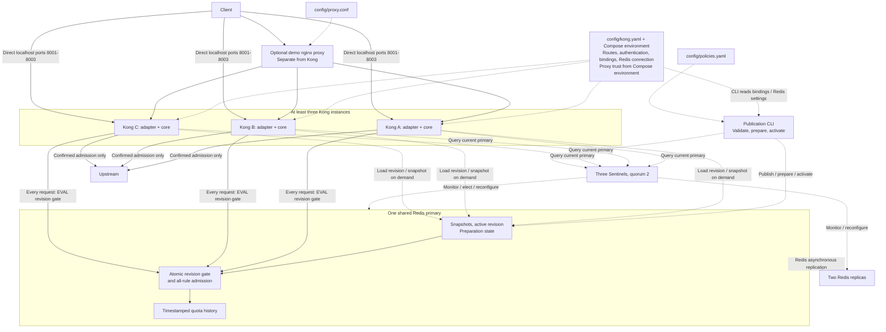
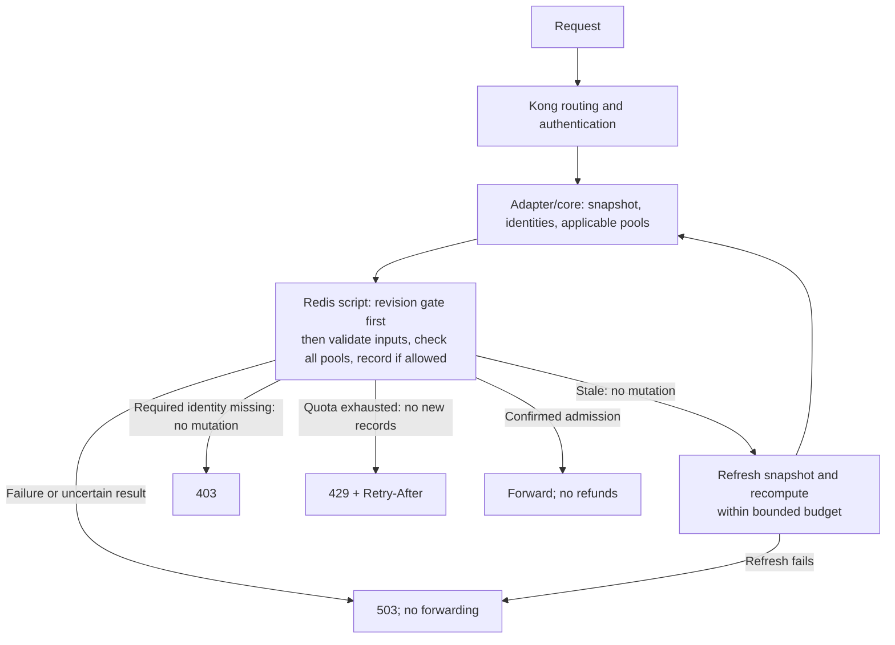

# Distributed rate limiting design

Status: Implemented take-home, with real Redis and three-Kong verification.
Selected decisions describe implemented behavior; production reconsiderations
are not implemented capabilities. Use the [README](../README.md) for commands
and the repository map, section 8 for evidence, and section 9 for production gaps.

## 1. Scope and contract

Build a Kong native plugin with an independent limiter core. At least three
gateway instances share quota through one Redis primary.

The assignment requires Request Path, Client ID, and IP dimensions, configurable
limits and windows, runtime updates, and HTTP 429 with Retry-After.

**Quota counts admitted HTTP requests, not bytes, successful business operations,
or concurrent work.** Every applicable rule must allow a request before one
admission is recorded in each pool. Confirmed quota rejection records nothing.
Expired-record cleanup is not new consumption.

Admission is permission to forward, not proof that the upstream executed.
Upstream errors, timeouts, and client disconnects do not refund quota. Client
retries are new requests. This protects upstream resources during failure and
avoids uncertain cross-pool compensation; success-based billing is a separate
concern.

Redis has one primary, two replicas and three Sentinels. Redis owns replication;
Sentinel owns election, and the limiter owns primary discovery/reconnection.
Automatic failover and controlled Redis maintenance are verified, with accepted
switching-time 503 and possible asynchronous loss of acknowledged counters or
policy revisions. There is no local fallback, ambiguous mutation replay, strict
partition fencing, or zero-RPO guarantee.

The submission excludes Kong rolling deployment, ingress replacement,
cross-host/AZ redundancy, cross-region disaster recovery,
a dedicated management API/UI, a persistent controller, arbitrary
composite identities, query-based quotas, and limiter-owned regex routing.
Protective concurrency caps remain unselected, not an implemented capability.
Request-rate limits alone cannot bound in-flight work when upstream latency grows.

## 2. Architecture



Solid arrows show request processing; dashed arrows show configuration, control
or replication. Clients query Sentinel and load policy; Redis does not push updates
to gateways. Primary/replica are current roles, not permanent Compose service names.
The optional demo nginx reads `config/proxy.conf`; it is not Kong's configuration.
The core is a module inside Kong, not a network service.

| Component | Responsibility |
| --- | --- |
| Kong and adapter | Routing, configured authentication, proxy trust, plugin scope selection, request extraction, and HTTP responses. |
| Independent limiter core | Rule matching, pool identity, snapshot refresh, and decision orchestration. |
| Redis scripts | Revision validation, common time, atomic multi-pool accounting, and policy activation. |
| Publication CLI | Validate authored policy, prepare history, publish and activate snapshots, and report status. |
| Redis replicas and Sentinel | Native asynchronous replication, primary election, discovery and reconfiguration; not limiter code. |

Keep two operator-authored YAML files with separate responsibilities: Kong
deployment configuration and limiter policy. Redis is the runtime policy
authority; gateway-local copies do not independently activate limiter rules.

The CLI is outside the request path. Exiting it leaves activated policy usable;
interrupted preparation requires resuming the CLI to finish activation. Control
and data responsibilities are separated, but Redis remains their shared dependency.

## 3. Algorithm and distributed accuracy

**Select an exact sliding window log.** A rule permits at most `limit` admissions
in `(now - window_seconds, now]`, measured at Redis admission time.

| Aspect | Exact sliding window log | Token bucket |
| --- | --- | --- |
| Contract | Strict rolling-window count. | Sustained refill rate with bounded burst capacity. |
| Configuration | Request limit and window duration. | Tokens per second and capacity. |
| Burst behavior | An empty window can admit its entire limit immediately. | A full bucket can spend its capacity immediately, then admit as tokens refill. |
| State per pool | Unique timestamped admissions over the retention horizon. | Constant-size balance and last-refill state. |
| Redis work | Sorted-set range counting, insertion, and cleanup; cleanup cost grows with expired records. | Constant-size arithmetic and state updates, with time/numeric handling. |
| Retry-After | Enough recorded admissions must expire. | Enough tokens must refill. |

A 100-per-60-second exact window can admit 100 immediately, then no more until
records expire. A full capacity-100 bucket refilling at `100 / 60` tokens per
second can admit another 50 after 30 seconds. Neither is inherently inaccurate:
they enforce different contracts, and neither smooths all bursts.

The sliding window directly matches the assignment's window/threshold semantics
and is easy to verify. Accept higher memory and cleanup cost for this bounded
submission. Reconsider token buckets for sustained-rate/burst requirements or
unacceptable measured state cost. Fixed windows permit boundary bursts; weighted
sliding counters are approximate; queued leaky buckets add waiting and lifecycle
complexity. Implement only the selected algorithm.

The algorithm alone is not a distributed guarantee. Require:

- All gateways use the same policy binding, rule IDs, and identity extraction.
- All decisions use the same Redis primary, without replica reads or local quota
  fallback. Every evaluation validates the active revision.
- One short Lua script checks all pools before adding any admission records.
- Redis TIME supplies a common decision timestamp.
- Every admission has a unique member; equal timestamps cannot overwrite requests.
- Cleanup and key expiry preserve all required history; retained records outside
  the active window do not count.

With 99/100 active records, competing scripts execute without interleaving:
the first inserts record 100, and the next rejects. Validate arguments and state
types before writes. Lua provides isolation, not rollback; unexpected runtime
errors can leave partial state and must never become successful admissions.

The bound concerns admission decisions, not upstream arrival/completion times.
It assumes retained state and a well-behaved Redis clock. Clock jumps, eviction,
restart data loss, and failover can invalidate that assumption. Do not claim
strict consensus or zero over-admission through those failures.

## 4. Rules, identity, and configuration isolation

Keep one flat `rules` list per policy. The following illustrates the schema of
`config/policies.yaml`, separate from Kong deployment configuration. The runnable
example uses small three-second windows instead of these illustrative values.

```yaml
namespace: demo
policies:
  - id: public-api
    rules:
      - id: orders-total
        limit_by: path
        path: /orders
        path_match: prefix
        limit: 1000
        window_seconds: 60
      - id: client-total
        limit_by: consumer
        limit: 100
        window_seconds: 60
      - id: client-orders
        limit_by: consumer
        path: /orders
        path_match: prefix
        limit: 60
        window_seconds: 60
      - id: ip-total
        limit_by: ip
        limit: 200
        window_seconds: 60
```

| Rule | Shared by | Applicability |
| --- | --- | --- |
| Path | Everyone matching the configured path. | Explicit path match. |
| Consumer | Requests with the same Kong Consumer ID. | Entire plugin scope, or optional path filter. |
| IP | Requests with the same trusted client IP. | Entire plugin scope; IP path filters are not selected. |

For Alice requesting `/orders`, all four sample pools must allow admission.
If Alice's total is exhausted, none receives a new record even if the others have
capacity. Her `/products` request skips both orders rules.

Per-client path limits are additional ceilings, not reserved allocations. Their
sum need not equal the total; unused capacity is not transferred. Consumers get
their own pools automatically without per-user YAML entries. Repeated fields are
an accepted cost of explicit flat rules; avoid inheritance and allocation logic.

### Path matching

Use Kong's normalized `kong.request.get_path()`, excluding query strings.
Path rules require both `path` and `path_match`; Consumer filters specify both
or neither. Reject unknown modes and duplicate rule IDs.

| Request | Exact `/orders` | Segment-boundary prefix `/orders` |
| --- | --- | --- |
| `/orders` or `/orders?page=2` | Match | Match |
| `/orders/123` or `/orders/456/items` | No match | Match |
| `/orders-backup` | No match | No match |

Matching descendants share the configured-path pool, not one pool per resource
ID. Nonmatching rules are skipped, never converted to IP rules. Overlapping rules
all apply; there is no implicit longest-match override. Prefix groups a subtree,
not an inferred endpoint template. Complex route selection remains Kong's job.
Prefix `/` matches everything. A trailing slash is significant: prefix `/orders/`
matches itself and descendants, not `/orders`. Authored paths must be absolute
canonical text, at most 1024 bytes, without percent escapes, repeated slashes, dot
segments, query, fragment, backslash or controls. Kong normalizes incoming paths;
the core additionally discards query suffixes. Rejecting ambiguous authored paths
is simpler than duplicating Kong's normalization; revisit for encoded-path policy
requirements. Runtime path input is bounded to 8192 bytes.

### Consumer identity and authentication

Client ID means authenticated Kong Consumer ID. Authentication plugins validate
credentials first and own their rejection responses, normally HTTP 401.
The limiter does not enable/disable authentication or validate credentials.

If an applicable Consumer rule lacks identity, return HTTP 403 and log the reason,
without quota consumption. Validate the policy revision before emitting this
response; Redis may be contacted for that check, but no quota mutation is attempted.
Skipping or falling back to IP would silently change mandatory per-client policy.

Missing Consumer does not always prove failed authentication: public routes,
external authentication, anonymous Consumers, or plugin ordering can explain it.
Use Consumer-backed authentication before the limiter and disable anonymous
authentication for Consumer rules in the demonstration. Path/IP-only policy does
not require Consumer, but independent authentication may still protect that route.
External identities or public-client policies need explicit future mappings.

### Trusted IP

Use `kong.client.get_forwarded_ip()`. Operators configure `trusted_ips`,
`real_ip_header`, and `real_ip_recursive` to match the actual topology consistently
on all gateways. Trust only controlled proxies, which must sanitize or correctly
append forwarding headers. Otherwise use the direct peer address, possibly the LB.
Never unconditionally accept client-supplied forwarding headers.

This preserves client IP behind a trusted LB without duplicating gateway logic.
Direct-peer-only accounting groups everyone behind that LB. Shared NAT egress
still shares quota; IP is not a unique user. Revalidate trust when topology changes.

### Independent configurations

Separate configurations have separate pools. Express shared total and per-path
limits together in one configuration covering the intended requests.
Kong's same-plugin precedence selects a configuration; narrower bindings do not
automatically add to a global instance.

Logical pool identity:

```text
(namespace, stable configuration identity, rule ID, extracted identity)
```

The binding identity is stable across replicas and updates, not generated per
node, worker, or revision. Use the configured binding, not each request's Route:
otherwise a global total would accidentally split by Route. Activation and
preparation metadata use the same isolation boundary. Redis keys use `drl:<namespace>:<policy_id>:`. Namespace, policy and rule IDs use
1-64 ASCII letters, digits, hyphens or underscores. Identity bytes are hex-encoded,
so separators, resource IDs and IPv6 addresses cannot collide. Pool keys exclude
revision, limits and windows; a persistent per-binding sequence makes admission
members unique even with equal Redis timestamps.

Matching rule names across configurations do not imply sharing. Explicit
cross-configuration policies would require ownership and update consistency
rules and are outside the submission.

## 5. Request outcomes



Identity extraction belongs to the adapter/core; the script receives availability
information, not credentials. Logical steps inside the script are not separate
read-then-write calls. Even a cached policy matching no rules passes the revision
gate before forwarding. Cold-cache/bootstrap failure cannot imply unrestricted
access; Compose publishes policies before starting gateways and checks process
health, while the verification script exercises real HTTP readiness.

### Retry-After

Return integer delay-seconds, rounded up and at least one second, covering the
longest required wait across exhausted rules at the same Redis decision time.

For an exhausted pool with `count` active records and limit `limit`, find the
expiration of its `count - limit + 1` oldest active record (one-based). This waits
for enough records to leave after a limit decrease, not merely the oldest.
History outside the active window must not affect the calculation.

Waits of 3.2 and 8.1 seconds produce `Retry-After: 9`. This is not a reservation:
competing requests or policy updates can change availability. Delay-seconds avoids
client clock synchronization, accepting upward-rounding delay. Do not invent a
quota-reset header for identity or dependency errors; preserve upstream responses.

### Redis failures

**Current take-home decision: fail closed.** Unavailable connections/primary
discovery, execution failures, missing or damaged active policy, refresh failure,
or unconfirmed admission return HTTP 503 without forwarding, directly affecting
the business data plane. Use finite
connection, operation, and refresh budgets; log internal causes without exposing
addresses or secrets to clients.

When a trustworthy limiter decision is unavailable:

| Choice | Behavior and trade-off |
| --- | --- |
| Current: fail-closed | Return 503 without forwarding, sacrificing business availability. This is our policy choice, not a Sentinel/Redis requirement. |
| Future: storage-outage fail-open or bounded local fallback | Continue forwarding to prioritize data-plane availability, accepting possible shared-limit overruns and upstream overload; forwarding does not guarantee upstream availability. |

Section 9 defines the future degradation boundary: do not automatically allow
configuration/policy or identity errors; confirmed quota exhaustion remains 429.
This availability choice is separate from consistency: even fail-closed cannot
prevent over-admission when asynchronous failover loses history and the new
primary returns a valid allow decision against its reduced history.

A lost response may follow a completed mutation: HTTP 503 can consume quota
without upstream forwarding, and admission counts are not actual billing.
Accept this conservative under-admission. Do not
blindly retry mutations or perform uncertain refunds. Confirmed nonmutating
results, such as stale policy, are different from ambiguous network timeouts.
Fail-closed does not reconstruct lost history after recovery.

Sentinel discovery and primary `ROLE` validation happen before admission.
Connection failures before sending EVAL can trigger bounded rediscovery.
A top-level `READONLY` reply is also a confirmed pre-execution rejection:
invalidate the old connection/cache and recompute against the discovered primary.
Only this classified result can repeat EVAL after demotion; timeout, EOF, reset,
unknown script error or malformed reply cannot.

Lua briefly caches discovery for 500ms and verifies ROLE whenever a connection
is checked out. Changed endpoints and recovery generations quarantine old pools;
old idle sockets expire through OpenResty's bounded keepalive, not a claimed
API that synchronously closes every idle socket. Retired snapshot cache keys
are removed. Python uses redis-py Sentinel discovery plus explicit no-retry Redis
connections, rather than a library wrapper that converts demotion into a generic
retryable connection error. Both access the current primary, never replicas.

Sentinel and ROLE are not strict fencing: an isolated old primary can temporarily
remain writable. Asynchronous loss can roll back quota or active revisions.
Gateways refresh against whichever revision the current primary retains, including
older revisions; monotonic publication across failed replication is not promised.
Automatic HA recovery does not make every switching-time request transparent or
guarantee zero acknowledged-write loss. Admission deduplication alone does not
repair asynchronous replication loss.

## 6. Dynamic publication

**Supported limit/window updates should not intentionally interrupt traffic or
reset quota.** This is verified for the supported scenarios, not a blanket guarantee
of zero errors, zero latency, or unchanged outcomes. Stricter policy can cause
legitimate HTTP 429; genuine dependency failure still causes HTTP 503.

```text
YAML -> CLI validation -> Complete snapshot -> Preparation if needed
                                           -> Atomic activation -> Gateway refresh
```

Publish a complete immutable snapshot before atomically activating its revision
in Redis. Every admission evaluation gates on that revision before cleanup or
mutation. Stale gateways refresh internally and recompute rules, identities, and
keys; repeated evaluations still gate against concurrent activation.

Redis serializes each binding's publication script and imposes a 100ms interval
between changes. An identical apply bypasses that throttle without changing state.
Publication across different bindings is not a global transaction.
Bound refresh work to eight confirmed-stale attempts and a configurable time budget. Normal version
lag alone must not immediately produce HTTP 503. Preloading can reduce latency.
Previously admitted requests finish under their admission decision, without
cancelation or a second charge.

The CLI reports actual publication states and exits nonzero on errors.
Reapplying identical YAML neither resets quota nor restarts preparation.
Preparation is resumable; exiting the command does not stop old-policy traffic,
but no controller automatically completes pending activation. A publisher failure
before activation leaves the existing policy active; completed snapshots remain
available without the publisher. Activation timeouts require status reconciliation,
not an unsupported claim that the update certainly failed or blindly succeeded.

### Changing limits

Keep history and pool keys stable; limits and revisions are not key components.
With 80 admissions in 60 seconds, changing 100 to 50 rejects until fewer than 50
remain; changing 100 to 200 leaves 120 available at that instant, absent competitors.
An update cannot undo prior admissions or retroactively enforce the lower bound.
Resetting would grant extra quota and enable repeated-update bypasses.

### Changing windows

Separate **counting window** from **retention horizon**. Range-count only the active
window; cleanup and TTL cover the larger required horizon.

For 60 -> 120 seconds when complete longer history is unavailable:

1. Atomically activate a preparation revision retaining at least 120 seconds while
   still enforcing the old 60-second policy. Record the boundary with Redis TIME.
2. Revision gating prevents stale nodes from pruning or setting TTL under old
   retention settings. Continue admitting normal old-policy traffic.
3. Conservatively wait a full 120 seconds from that boundary, then activate the
   new window using preserved admissions, if readiness remains valid.

Existing inactive keys may expire under old TTLs during preparation. The full
new-window wait ages out those pre-boundary records; surviving records or a longer
TTL alone do not prove readiness. Restart, eviction, or lost preparation state
must not be mistaken for complete history.

A shorter window needs no new history. Rolling back to a larger window requires
the same readiness check. Reject unsupported retention sizes explicitly; serialize
conflicting changes. Canceled preparation leaves the old rules active with the enlarged retention
horizon; it never restores destructive old cleanup settings. Retention does not
automatically shrink. Every later window increase conservatively prepares again,
even if the retained horizon is already large. Accept extra storage and activation
delay rather than maintaining per-pool history-completeness metadata.

Preparation records Redis `run_id`; a new incarnation restarts the full wait when
apply resumes. Nonmutating status reports `rewarming` on incarnation mismatch,
not an old deadline's zero-delay readiness. Promotion changes the primary
incarnation even if its process was already running as a replica.
Missing or malformed preparation metadata is an error in both
status and apply, not readiness. Deadlines must be finite positive timestamps,
and the preparation incarnation ID must be present and nonempty. Cancel remains
available to discard a damaged preparation without resetting the old policy.
This detects restart boundaries, not arbitrary undetected eviction or data loss.
The demo uses AOF and `noeviction`; acknowledged history can still be lost after
crashes. No claim of uninterrupted durability is made.

Accept delayed activation and temporary storage cost, not planned traffic
interruption or underestimated history. Retained data alone does not establish
history completeness; a controller cannot manufacture missing history.

### Supported change boundary and management scale

The continuity contract covers limits/windows within stable rule membership,
identity, path coverage, and Kong scope. Adding/removing rules, changing dimensions,
paths, namespaces, or bindings needs a migration design; do not silently activate
an empty replacement pool as preserved history. Until supported, reject such live
changes while leaving active policy unchanged. Authentication/trust changes are
outside this limiter's publication contract.

Low-frequency updates and small flat YAML fit the submission. CLI can be automated,
but manual review, repetition, concurrency, warmup, and refresh churn limit scaling.
Schema validation cannot establish business intent.

| Production trigger | Reconsideration |
| --- | --- |
| Frequent changes or unattended preparation | Persistent controller for resumable reconciliation and activation; outside the request path. |
| Large/repetitive policies | Validated templates/generation, previews, ownership, and review boundaries. |
| Self-service/programmatic workflows | Authenticated, authorized, audited API reusing CLI publication semantics. |

These are options, not mandatory production components or separate authorities.
Controller failure should delay updates, not stop already configured traffic.

## 7. Deployment configuration and implementation

Decision: Maintain Kong deployment and limiter policy in separate YAML files.
They do not duplicate the same rule source: Kong stores bindings and connection
settings; only the policy file stores limits, windows, and matching rules.

| File | Contents and update path |
| --- | --- |
| `config/kong.yaml` | Kong services, routes, Consumers/authentication, and limiter bindings. Use Kong's deployment/configuration mechanisms. |
| `config/policies.yaml` | Limiter policies and rules. Use the publication CLI for supported live updates. |

Binding: the plugin config contains `namespace`, `policy_id`, and Redis
connection settings. The policy document contains the same namespace and an
explicit stable policy ID. A policy identifies one independent binding, replicated
across the gateways; unrelated bindings must not reuse it. This ID supplies the
stable configuration identity rather than a generated Kong plugin UUID.

Sentinel bindings set `redis_mode: sentinel`, `sentinel_master: limiter` and a
bounded `sentinel_nodes` host/port list. Redis and Sentinel have separate optional
credentials/TLS fields. The Python CLI reads the same referenced binding.
Explicit direct mode remains for standalone deployments/tests; a direct URL
override conflicts with Sentinel mode and is rejected, never silently substituted.

The CLI validates that every policy has exactly one binding reference in the
single replicated Kong deployment document; duplicate, missing and unknown
references fail validation. Kong schema also validates binding IDs. Service,
Route and global bindings are supported; Consumer-scoped plugin bindings are not
selected (Consumer is a rule dimension, not a plugin scope). Invalid pending updates leave existing policy
unchanged; a runtime binding with no active policy fails closed. Rules are not
duplicated in `kong.yaml` or used as a silent local fallback.

Bootstrap and follow-up verification:

```text
Compose: Redis/Sentinel PING -> CLI policy bootstrap -> Kong process health
Follow-up: ha.py status -> actual HTTP probes/integration tests
```

Compose startup does not itself verify replica offsets or Sentinel quorum.
`scripts/ha.py status` checks roles, replica links/offsets, all Sentinel addresses
and quorum; the HA verification/maintenance tools require that topology first.

Controlled maintenance upgrades replicas first, then pauses primary writes,
waits for catch-up and lets Sentinel choose/promote. Sentinel's transactional
demotion can be blocked by the write pause, so the tool issues non-transactional
`REPLICAOF` to the old primary only after observing a unique promoted peer.
It confirms the old node is a replica before unpausing, waits for convergence
and replaces the old member. It never forces a candidate or guesses a rollback.
The native pause expires after 10s; incomplete handoff requires role inspection.
The desired image comes from Compose, not hidden runtime overrides. Follow the
README maintenance procedure before ordinary up when changing that image.

Kong proxy trust and process settings remain in its deployment environment,
not the limiter rules. Authentication, routing, binding identity, and Redis endpoint
changes are not promised by the limiter's live-policy update contract.

The two-file choice makes ownership clear and avoids regenerating routing
configuration for ordinary policy changes. Its cost is reference validation.
A single authored document plus generated deployment configuration was considered
but not selected. Reconsider generation only if real configuration scale warrants it.

The layout follows Kong's plugin discovery convention; no extra service or
packaging framework is required:

| Module | Responsibility |
| --- | --- |
| `handler.lua`, `schema.lua` | Kong request adapter and plugin binding validation. |
| `core.lua` | Shared validation, matching, pool identity and decision orchestration. |
| `store.lua`, `primary.lua` | Snapshot access, Sentinel discovery and primary-only connections. |
| `admission.lua`, `publication.lua` | Atomic Redis admission and policy preparation/activation. |
| `scripts/publish.py`, `scripts/redis_connection.py` | Operator CLI and explicit no-retry Python connections. |
| Other `scripts/` files | Local Redis bootstrap, sample upstream and demo verification/maintenance. |

Keep the small Python entry points together: adding parallel `src/`, `bin/` or
deployment trees would add indirection without a separate package or platform.

Keep functions and modules small, without a framework or separate limiter service.
Core matching logic must not import Kong request APIs; the adapter passes request
facts and the storage interface. The same `core.lua` validator executes in publication and admission scripts and
gateway snapshot loading. Python validates YAML uniqueness and deployment
references, not a competing rule schema. Admission scripts use the independent
core to match trusted request facts and derive pool keys; callers cannot submit
unchecked quota keys. The adapter only extracts Kong PDK facts and returns HTTP.

The store caches immutable snapshots per worker. Every request still passes the
Redis revision gate; stale replies invalidate the cache and reload internally.
Use direct `EVAL`, rather than a script-cache abstraction, for readability and no
uncertain mutation retries. This sends the shared core/script source on each
evaluation and validates snapshots again inside Redis. Accept bandwidth/CPU cost
for the submission; production latency/capacity may justify `EVALSHA` with safe
`NOSCRIPT` handling and leaner validated snapshot access.

Limits: 1-32 rules, integer limits 1-10000, integer windows/retention 1-3600 seconds,
64 KiB authored policy JSON. These are input bounds, not a production memory
capacity guarantee; short windows and long preparation horizons can retain many
more than `limit` records. History TTL is retention plus one second and cleanup
removes records at or before the retention boundary only on confirmed admission.
Immutable historical snapshots are retained, without a garbage collector;
frequent publication needs an audited snapshot-retention/cleanup policy.

Redis connection/read/write timeouts default to 200ms; refresh defaults to one
second beginning before discovery, with eight confirmed-stale attempts and at
most one classified READONLY reconnect. Python bounds discovery/reconnect attempts
and uses no automatic mutation retry. Recovery resumes on later requests; it
does not wait for an entire election inside one HTTP request. DNS resolution is owned by Kong, not the Redis socket
budget. The IPv4 Docker demonstration explicitly uses `LAST,A,CNAME` DNS order,
excluding unused SRV lookups. Revisit discovery settings for SRV/IPv6 deployments.
Kong health checks establish process readiness; publisher completion establishes
policy bootstrap, and HTTP checks establish actual request-path readiness.

Python 3.12, pinned `redis`/`PyYAML`, and standard-library `unittest` keep packaging
small. Compose pins Kong 3.9.1, Redis 7.4.3, Sentinel 7.4.2, Python 3.12.10 and nginx 1.27.5.
These are reproducibility pins, not a claim of current production patch status.

## 8. Verification

Run `sh scripts/check.sh` in Linux or use the README's WSL command. The verified
environment uses Docker Engine and Compose inside Ubuntu WSL2, without Docker
Desktop. The script rebuilds the gateways, runs isolated Redis tests in DB 15,
then exercises the demo namespace in DB 0. It restores authored policies and
leaves services running; it does not prune volumes or unrelated resources.

### Latest complete run

On 2026-11-15, `sudo -n sh scripts/check.sh` exited 0:

| Check | Evidence |
| --- | --- |
| Core/accounting/publication/CLI/connections/tools | 29 tests passed in 4.940s. |
| Three-Kong HTTP integration | 10 tests passed in 6.391s, including 80 concurrent requests: 12 admitted and 68 rejected under four shared rules. |
| Primary plus one Sentinel paused | `redis-c` -> `redis-b`; all gateways recovered without restart in 4.853s. Traffic: 57 HTTP 200, 18 HTTP 503; maximum latency 0.805s. |
| Preparation after promotion | Status reported `rewarming`; apply restarted a full new-window wait. Restored members rejoined. |
| All Redis members paused | `[503, 503, 503]`, followed by `[200, 200, 200]` after recovery. |
| Controlled same-version replacement | All members remained on Redis 7.4.3; `redis-b` -> `redis-c`; synchronized marker retained. Traffic: 2346 HTTP 200, 48 HTTP 503; maximum latency 0.204s. |
| Cleanup | Final primary `redis-c`; `public-api`, `isolated-api`, `identity-api` and `ip-api` all active. |

A separate real 7.4.2-to-7.4.3 upgrade also completed, preserving the synchronized
marker and passing role/link/quorum checks. Unlike that upgrade, the final
full-script maintenance phase recreated members at the already-declared version.
Both preserved existing volumes and role configuration.

HA traffic goes directly to the three gateways' `/free` endpoint. It validates
discovery, snapshot/revision checks and recovery, but matches no quota rules and
does not test ingress rollout or fault-time quota preservation. A replicated
marker is evidence for that marker, not proof that every acknowledged admission
survives failure. Counts aggregate each entire traffic phase; they do not identify
the cause or timing of each 503. Recovery thresholds and observed latencies are
local test results, not production SLOs.

### Test method and unverified boundaries

Core/accounting, CLI validation and focused preparation/discovery regressions
have observed red/green evidence. The first six publication tests preceded their
implementation, but the initial red run was not captured; a complete observed
publication TDD cycle is not claimed. Later real-Redis regressions cover malformed
preparation metadata, unchanged state on error, cancellation and old-policy
continuity. Real Sentinel promotion verifies incarnation-aware rewarmup.

Connection/discovery/command-order mocks supplement real Redis and three-Kong
tests; they cannot establish distributed atomicity or replication durability.
Ambiguous admission handling is tested at the orchestration/connection boundary
(no blind replay), not by injecting lost responses on a real Kong socket.
Production capacity, arbitrary clock jumps, partition fencing, cross-host/AZ
failures and lossless Kong rollout remain unverified.

## 9. Production gaps

These are business-dependent production considerations, not unfinished assignment
requirements or implemented promises. Assess them against the expected workload
and acceptable risk; no additional platform is mandatory.

**1. Failure policy.** Current fail-closed returns 503 and reduces business
availability. Future storage-outage-only fail-open or time-/quota-bounded local
fallback could keep forwarding, with monitoring and bounded recovery, but accepts
shared-limit overruns and cannot guarantee upstream availability. Do not bypass
identity or damaged-policy errors; confirmed quota exhaustion remains 429.

**2. Consistency and recovery.** Redis asynchronous replication during
Sentinel-managed failover can lose counts or policy revisions; ROLE does not
fence a partitioned old primary. Define over-/under-admission tolerance and
RPO/RTO; stricter consistency needs a different ownership/storage design.
Exercise backup/restore of policy, sequence and pool history together: missing
history must not silently become fresh quota. AOF, `noeviction` and `run_id` do
not prove complete history. Validate clock jumps and longer-window rewarmup.

**3. Performance and scale.** Exact logs grow with identity cardinality and
retention; hot keys, cleanup, ROLE checks, EVAL transmission and validation add
cost. Measure throughput, p95/p99 latency, memory and connection budgets before
optimizing. Bound snapshot growth without deleting active/preparing history.
Sharding must preserve all-rule atomicity; current code is not Redis Cluster-ready.
Rate limits also do not bound in-flight work; add concurrency protection only
if upstream behavior requires it.

**4. Security and identity.** Public demo keys and unauthenticated Redis/Sentinel
are not production settings. Use network isolation, verified TLS, tested
least-privilege ACLs and injected/rotated secrets. Keep Consumer identity and
trusted proxy mappings stable; audit path/IP normalization and retention/privacy.
Hex IP encoding is not anonymization.

**5. Configuration evolution.** The CLI fits small-scale updates. Higher change
volume may need controlled, authorized and audited publishing that reuses its
preparation/activation semantics, not a competing runtime authority.
Cross-binding publication can partially succeed; reconcile it explicitly.
Structural rule/identity/path changes need a history-preserving migration design.
Identity-system mapping (Consumers may be applications), GitOps for Services/Routes
and a policy platform are optional integrations; service discovery does not replace
route rules. Reviewed declarative YAML itself can be used in production.

**6. Deployment and operations.** Single-host Compose is not host/AZ redundancy.
Place Redis/Sentinels and gateways across suitable failure domains and provide
HA ingress/upstreams. Kong readiness, traffic withdrawal and in-flight draining
belong to deployment tooling; lossless rolling upgrades are not implemented.
Add bounded-cardinality decision/error/latency metrics, replication/memory and
preparation alerts, plus outage/restore/maintenance runbooks. Demo scripts are
not a production rollout controller.

Before rollout, agree workload-specific latency/error and recovery targets.
Extend section 8's evidence with load/soak, quota-matching fault traffic, real
socket lost responses/partitions, state restoration and compatible rolling
upgrade/rollback tests that preserve history. The existing `/free` HA checks
demonstrate recovery, not fault-time quota accuracy. Maintain reproducible CI,
dependency security updates and a tested version matrix; pins alone are not safety.

## References

- [Kong Rate Limiting](https://developer.konghq.com/plugins/rate-limiting/)
- [Kong plugin scope and precedence](https://developer.konghq.com/gateway/entities/plugin/)
- [Kong plugin lifecycle](https://developer.konghq.com/custom-plugins/handler.lua/)
- [Kong request PDK](https://developer.konghq.com/gateway/pdk/reference/kong.request/)
- [Kong client PDK](https://developer.konghq.com/gateway/pdk/reference/kong.client/)
- [Redis Lua scripting](https://redis.io/docs/latest/develop/programmability/eval-intro/)
- [Redis replication](https://redis.io/docs/latest/operate/oss_and_stack/management/replication/)
- [Redis Sentinel](https://redis.io/docs/latest/operate/oss_and_stack/management/sentinel/)
- [Redis CLIENT PAUSE](https://redis.io/docs/latest/commands/client-pause/)
- [Redis Cluster](https://redis.io/docs/latest/operate/oss_and_stack/management/scaling/)
